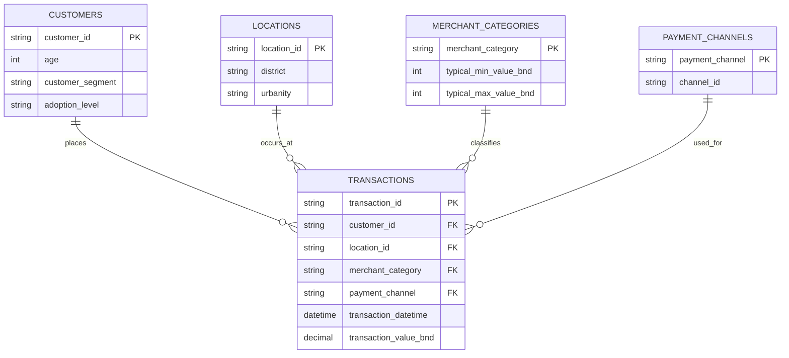

# Stage 2 — AI-Assisted Data Design and Generation

**Project:** Brunei Digital Payment Analytics  
**Deliverable owner:** Data Engineering  
**Status:** Complete — schema, data dictionary, generation script, CSV files, counts and assumptions documented below.

---

## 1. What was produced

| Artifact | Location | Purpose |
|---|---|---|
| Generation script | `digital_payment_analytics/generate_synthetic_data.py` | Deterministic, standard-library-only Python 3 script that builds all five CSVs |
| This report | `digital_payment_analytics/md/STAGE2_REPORT.md` | Prompts, schema, data dictionary, counts and assumptions |
| Main fact file | `digital_payment_analytics/data/transactions.csv` | 5,000 synthetic payment events |
| Supporting dimension | `digital_payment_analytics/data/customers.csv` | 300 synthetic customers |
| Supporting dimension | `digital_payment_analytics/data/locations.csv` | 100 synthetic locations in Brunei |
| Supporting lookup | `digital_payment_analytics/data/merchant_categories.csv` | 10 merchant categories and value rules |
| Supporting lookup | `digital_payment_analytics/data/payment_channels.csv` | 6 payment channels |

The generator is self-contained and recreates all five CSVs from scratch with no external inputs. The two lookup tables make referential integrity explicit; the reproduction check in §7 verifies the generated hashes.

---

## 2. AI prompts used

The AI assistant was used for schema design, script authoring and documentation. The prompts below are reproduced verbatim (Prompt 0 is the original Stage 2 brief; Prompts 1–3 are the follow-up refinement requests).

### Prompt 0 — Original brief (verbatim)

> Stage 2: AI-assisted data design and generation
> Design the schema and data dictionary. Use an AI assistant to help create a Python generation script and produce the main and supporting CSV files. Include the prompt(s), script, record counts and a brief explanation of the synthetic assumptions.

### Prompt 1 — Schema and data dictionary

> Act as a data engineer. Using the Stage 1 brief for a Brunei digital-payment analytics dataset, design a simple star-style schema: one transaction fact table plus supporting customer and location dimensions and small lookups for merchant category and payment channel. Write a Markdown data dictionary covering every column with data type, nullability, key role, description and example. State the primary/foreign keys and explicitly note the deliberate denormalisation of `customer_segment` and `adoption_level` into the transaction fact table for analyst convenience.

### Prompt 2 — Generation script

> Write a deterministic Python 3 script (standard library only, no pandas and no faker) named `generate_synthetic_data.py`. It must create five CSV files in a `data/` folder next to itself: `transactions.csv` (5,000 rows, main), `customers.csv` (300), `locations.csv` (100), `merchant_categories.csv` (10) and `payment_channels.csv` (6). Seed the RNG with 42 for full reproducibility. Include module/function docstrings, a `write_csv` helper, and a `main()` that prints record counts and output paths.

*(The clause requiring parity with the retired prototype has been omitted from this reproduced prompt.)*

### Prompt 3 — Summary and assumptions

> Summarise the generated record counts and the synthetic assumptions behind the generator in a short Markdown section: distributions by customer segment and district, time-of-day weighting, merchant value ranges and income scaling, channel/device rules, status and cross-border rates, currency handling, and the fact that no real personal or payment data is used. Add reproduction instructions and SHA-256 verification hashes.

---

## 3. Schema design

### 3.1 Entity relationships

```
   customers (1) ──────< (many) transactions >────── (1) locations
                                  │
                                  ├──────── (1) merchant_categories
                                  └──────── (1) payment_channels
```



### 3.2 Grain and keys

* **Fact grain:** one row in `transactions` = one synthetic payment attempt (successful, failed or pending) on one date/time, by one customer, at one location, in one merchant category, via one channel.
* **Primary keys:** `transaction_id` (`T000001`…`T005000`), `customer_id` (`C0001`…`C0300`), `location_id` (`L001`…`L100`), `merchant_category` (natural key), `payment_channel` (natural key).
* **Foreign keys:** `transactions.customer_id → customers.customer_id`, `transactions.location_id → locations.location_id`, `transactions.merchant_category → merchant_categories.merchant_category`, `transactions.payment_channel → payment_channels.payment_channel`.
* **Denormalisation:** `customer_segment`, `adoption_level` and `adoption_tenure_months` are copied from the customer master into each transaction. This is intentional: it lets analysts slice payments by adoption without a join, but the values must always match `customers.csv`.
* **No nulls:** every generated field has a value. `currency` is fixed to `BND`.

---

## 4. Data dictionary

### 4.1 `transactions.csv` — main fact table (17 columns)

| Column | Type | Null? | Key | Description | Example |
|---|---|---|---|---|---|
| `transaction_id` | string(8) | No | PK | Unique payment identifier, `T` + 6 digits | `T000001` |
| `customer_id` | string(5) | No | FK → customers | Customer who made the payment | `C0141` |
| `transaction_datetime` | timestamp `YYYY-MM-DD HH:MM:SS` | No | | Full event timestamp in 2025 | `2025-07-04 12:42:57` |
| `transaction_date` | date `YYYY-MM-DD` | No | | Date part derived from `transaction_datetime` | `2025-07-04` |
| `transaction_hour` | integer 0–23 | No | | Hour part derived from `transaction_datetime` | `12` |
| `day_of_week` | string | No | | Day name derived from `transaction_date` | `Friday` |
| `transaction_value_bnd` | decimal(10,2) | No | | Payment amount in Brunei dollars, > 0 | `4.67` |
| `payment_channel` | string | No | FK → payment_channels | Rail used for the payment | `Debit Card` |
| `merchant_category` | string | No | FK → merchant_categories | Merchant sector of the purchase | `Transportation` |
| `location_id` | string(4) | No | FK → locations | Where the event was recorded | `L008` |
| `transaction_status` | enum | No | | `Successful`, `Failed` or `Pending` | `Successful` |
| `device_type` | enum | No | | `Smartphone`, `Computer` or `POS Terminal` | `Smartphone` |
| `customer_segment` | enum | No | Denorm. | Segment copied from customer master | `Young Professionals` |
| `adoption_level` | enum | No | Denorm. | `High`, `Medium` or `Low`, copied from customer | `High` |
| `adoption_tenure_months` | integer 1–60 | No | Denorm. | Months since adoption, copied from customer | `55` |
| `is_cross_border` | enum | No | | `Yes` or `No` flag | `No` |
| `currency` | string(3) | No | | ISO-like currency code, constant `BND` | `BND` |

### 4.2 `customers.csv` — customer dimension (10 columns)

| Column | Type | Null? | Key | Description | Example |
|---|---|---|---|---|---|
| `customer_id` | string(5) | No | PK | Unique customer identifier, `C` + 4 digits | `C0001` |
| `age` | integer 18–80 | No | | Synthetic age in years | `35` |
| `gender` | enum | No | | `Male` or `Female` | `Male` |
| `occupation` | enum | No | | `Student`, `Private Sector`, `Government`, `Self Employed`, `Retired`, `Other` | `Private Sector` |
| `customer_segment` | enum | No | | `Tech Savvy`, `Young Professionals`, `Working Adults`, `Traditional Users`, `Senior Citizens` | `Working Adults` |
| `adoption_level` | enum | No | | `High` / `Medium` / `Low`, determined by segment | `Medium` |
| `adoption_tenure_months` | integer 1–60 | No | | Months since first digital-payment use; capped at 60 for High adoption, 36 otherwise | `18` |
| `monthly_income_bnd` | integer | No | | Monthly income band in BND, one of 500, 1000, 1500, 2000, 2500, 3000, 4000, 5000, 6000 | `1500` |
| `primary_payment_channel` | enum | No | | Preferred channel, one of four | `Mobile Wallet` |
| `digital_payment_frequency` | enum | No | | `Daily`, `Weekly`, `Monthly` or `Occasional` | `Daily` |

### 4.3 `locations.csv` — location dimension (7 columns)

| Column | Type | Null? | Key | Description | Example |
|---|---|---|---|---|---|
| `location_id` | string(4) | No | PK | Unique location identifier, `L` + 3 digits | `L001` |
| `district` | enum | No | | `Brunei-Muara`, `Belait`, `Tutong`, `Temburong` | `Brunei-Muara` |
| `area_name` | string | No | | Town/area name within the district | `Muara` |
| `urbanity` | enum | No | | `Urban`, `Suburban` or `Rural` | `Urban` |
| `country` | string | No | | Constant `Brunei Darussalam` | `Brunei Darussalam` |
| `latitude` | decimal(5) | No | | Illustrative latitude, uniform in 4.5–5.1 | `4.50711` |
| `longitude` | decimal(5) | No | | Illustrative longitude, uniform in 114.5–115.5 | `115.02942` |

### 4.4 `merchant_categories.csv` — merchant lookup (4 columns)

| Column | Type | Null? | Key | Description | Example |
|---|---|---|---|---|---|
| `merchant_category` | string | No | PK | Natural key matching `transactions.merchant_category` | `Grocery` |
| `typical_min_value_bnd` | integer | No | | Lower bound of generated value range | `5` |
| `typical_max_value_bnd` | integer | No | | Upper bound of generated value range | `150` |
| `selection_weight` | integer | No | | Relative probability used when sampling the category | `18` |

### 4.5 `payment_channels.csv` — channel lookup (3 columns)

| Column | Type | Null? | Key | Description | Example |
|---|---|---|---|---|---|
| `payment_channel` | string | No | PK | Natural key matching `transactions.payment_channel` | `Mobile Wallet` |
| `channel_id` | string(4) | No | | Short code `PC01`–`PC06` | `PC01` |
| `channel_description` | string | No | | Plain-language definition of the rail | `Wallet balance or linked-account mobile payment` |

### 4.6 Validation rules

1. `transaction_date`, `transaction_hour` and `day_of_week` must equal the corresponding parts of `transaction_datetime`.
2. Every foreign key in `transactions` must exist in its dimension/lookup table.
3. Denormalised segment/adoption fields must exactly match the referenced customer record.
4. `transaction_value_bnd` must fall in (or close to, after income scaling) the range in `merchant_categories.csv`.
5. Enumerated columns may contain only the values listed above; `currency` is always `BND`.
6. All IDs are unique within their table and follow the documented prefixes/padding.

---

## 5. Generated files and record counts

Counts exclude the header row and were produced by `generate_synthetic_data.py` on this run.

| File | Role | Data rows | Columns |
|---|---|---:|---:|
| `transactions.csv` | Main fact table | **5,000** | 17 |
| `customers.csv` | Supporting dimension | **300** | 10 |
| `locations.csv` | Supporting dimension | **100** | 7 |
| `merchant_categories.csv` | Supporting lookup | **10** | 4 |
| `payment_channels.csv` | Supporting lookup | **6** | 3 |
| **Total** | | **5,416** | — |

Date coverage of the fact table: **2025-01-01 to 2025-12-31**. Currency: **BND** throughout.

---

## 6. Synthetic assumptions (brief explanation)

* **No real data.** Every customer, location, amount and timestamp is fabricated. There are no names, contact details, account numbers or card numbers — only anonymous surrogate IDs.
* **Determinism.** A fixed seed (`random.seed(42)`) makes all five files reproducible, which supports testing and avoids accidental drift between runs.
* **Population mix.** 300 customers are sampled into five segments with weights 25% Tech Savvy, 25% Young Professionals, 25% Working Adults, 15% Traditional Users and 10% Senior Citizens. Segment controls age band, adoption level, tenure cap, preferred channel and digital frequency.
* **Geography.** 100 locations follow district weights 60% Brunei-Muara, 20% Belait, 12% Tutong, 8% Temburong. Brunei-Muara is modelled as entirely urban. Coordinates are uniform draws inside a Brunei bounding box — illustrative only, not real geocodes.
* **Timing.** 5,000 transactions are spread uniformly across calendar 2025, with hours weighted toward daytime/evening (07:00–23:00, peak 17:00–21:00). No holiday or seasonal campaign effects are modelled.
* **Amounts.** Merchant categories have fixed plausible BND ranges (e.g. Transportation 2–50, Travel 50–1500) and category weights (Restaurant 20, Grocery 18, Retail 16, …). Amounts are scaled by income using `0.8 + (monthly_income / 2500) * 0.2` and rounded to 2 decimals, so higher-income customers spend modestly more.
* **Channels and devices.** Channel preference is segment-specific; low-adoption customers sometimes fall back to Debit/Credit Card or Bank Transfer. Urban locations add a 15% chance of switching to Mobile Wallet or QR. Device follows the channel: wallet/QR → Smartphone; online banking → Smartphone or Computer; others → Smartphone, Computer or POS Terminal.
* **Outcomes.** Status is 94% Successful, 4% Failed, 2% Pending. Cross-border flag is 5% Yes / 95% No. No fraud or dispute labels are generated.
* **Scope.** One currency (BND) with no FX conversion, no merchant IDs, no device IDs, no null values and no returns/refunds. These omissions keep the dataset focused on adoption and channel analytics.

---

## 7. Reproduction and verification

Run from the workspace root:

```powershell
python digital_payment_analytics\generate_synthetic_data.py
```

or from any directory:

```bash
python path/to/digital_payment_analytics/generate_synthetic_data.py
```

Expected console output includes the five row counts shown in §5. SHA-256 hashes after the run:

| File | SHA-256 |
|---|---|
| `transactions.csv` | `6E6556889C3AD29148AF867C6690D15860BED8ECB49D419E787AD90017C01937` |
| `customers.csv` | `74B9EFF854EB89117D0F2C85417B1876EB0A8BBC5110D5E092042298E93B4D0D` |
| `locations.csv` | `54B3EBCFE2C6060C0003731D9F7175882B2BF1036E6CA50DC23553194C2B879E` |
| `merchant_categories.csv` | `6067203B3ACCC10F99A06C32255DDB70D08DC700F9B015C4584F299AD170A452` |
| `payment_channels.csv` | `5236AC75DCE0CD160B9AB48F0F19C9F97B83CED8585AEB0ECA5AA81F1E1F6056` |

These hashes are stable across regenerations, confirming the generator is fully deterministic and that the five-file output set is reproducible.
